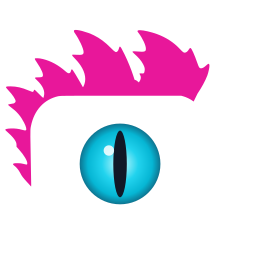
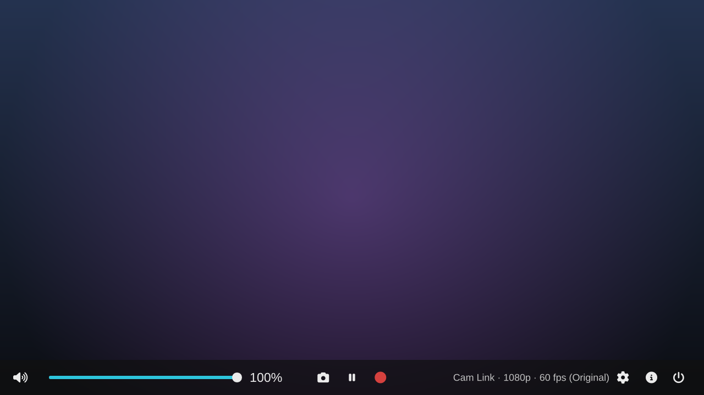
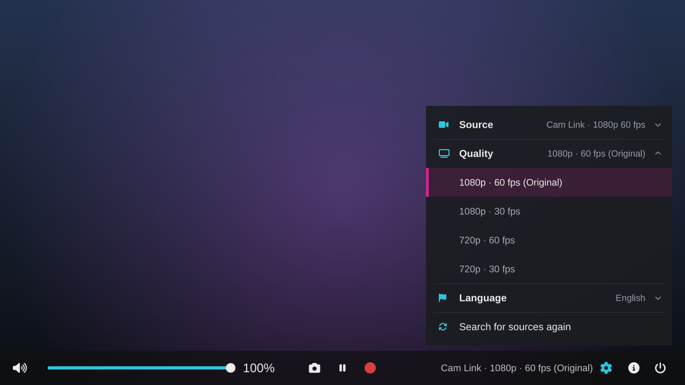
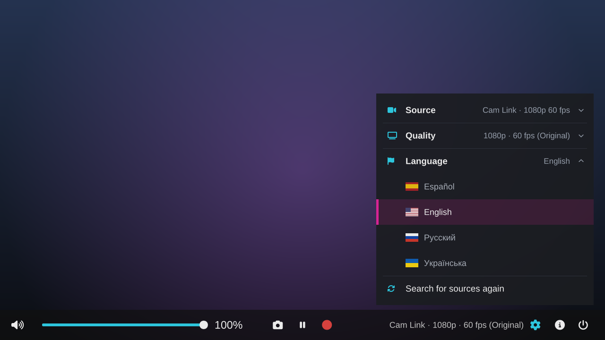
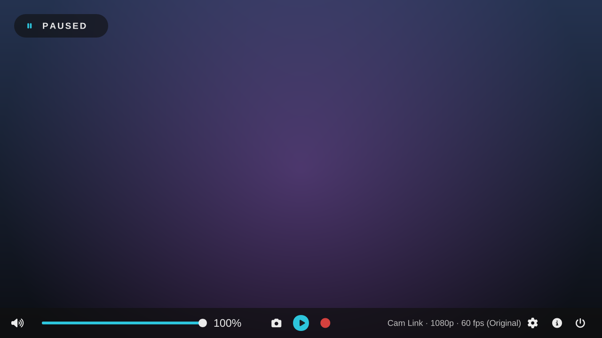
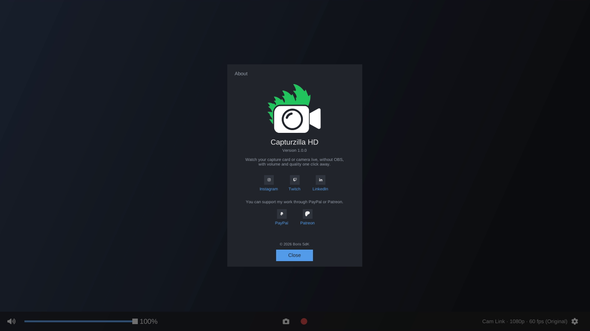
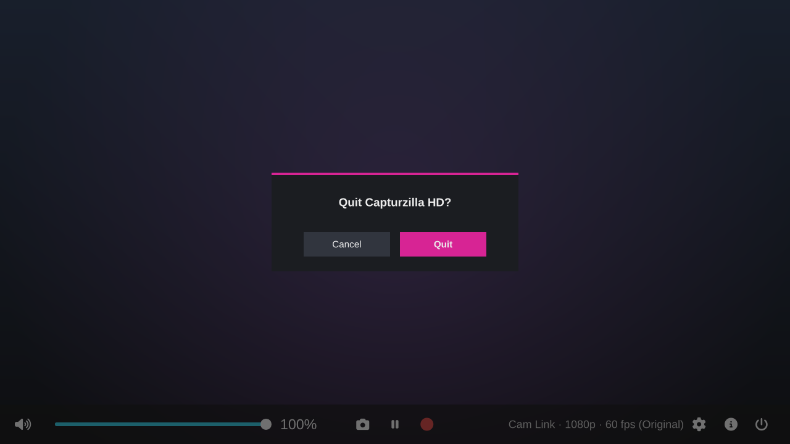

<div align="center">
  

  <h1>Capturzilla HD</h1>

  <a href="https://github.com/borferkic/Capturzilla-HD/releases/latest"></a>
  
  <a href="LICENSE"></a>
  <br />
  <a href="https://paypal.me/borissdk"></a>
  <a href="https://patreon.com/borissdk"></a>

  <p><a href="#english">English</a> | <a href="#espanol">Español</a></p>
</div>

<a id="english"></a>

**A minimal, low-latency viewer for your capture card or webcam on Omarchy: watch it live, control the volume, take screenshots and record, without OBS.**

Latest release: `2.1.0`.

<div align="center">
  
</div>

---

## Features

- **Live view**
  - Shows a capture card (such as the Elgato Cam Link) or a webcam at its best mode, for example 1080p 60 fps uncompressed, with low latency through mpv.
  - Plays the audio of the same device automatically.
  - If a source has no signal, a notice appears and the window stays open.
- **Bottom bar**
  - Volume slider, mute button and percentage. It appears when you move the mouse and hides after 2.5 s.
  - Screenshot, pause and record buttons in the center, with the recording time.
  - Status with the current source and quality. Long device names are shortened with "…".
  - Gear, About and Quit buttons on the right. Quit asks for confirmation first.
- **Gear menu**
  - **Source**: every video device connected, each one with its best mode. The Cam Link always comes first.
  - **Quality**: the original mode (for example `1080p · 60 fps (Original)`), 1080p 30 fps, 720p 60 fps and 720p 30 fps. It only changes the preview, never the recording.
  - **Language**: Español, English, Русский and Українська, with flags. The choice is remembered.
  - **Search for sources again**.
- **Pause**
  - Freezes the picture so you can look at it or take a screenshot. A `PAUSED` badge is shown, and resuming jumps back to the live picture.
- **Screenshots and recording**
  - Screenshots are saved as PNG in `~/Pictures/Capturzilla`.
  - Recordings are saved as MP4 (H.264 + AAC) in `~/Videos/Capturzilla`, always at the original quality, encoded by the GPU (NVIDIA NVENC). A `● REC` indicator with the time is shown while recording.
  - If you close the window while recording, the video is kept.
- **Omarchy style**
  - Closes with the Quit button or `Super+W` like any Omarchy window (not with `q`). Fullscreen is handled by Omarchy, and clicking inside the window never moves it.

## Screenshots

| Quality dropdown | Language dropdown |
|---|---|
|  |  |

| Paused picture | About | Quit confirmation |
|---|---|---|
|  |  |  |

## Quick start

1. Open the [latest release](https://github.com/borferkic/Capturzilla-HD/releases/latest) and download the source code, or clone the repository.
2. Run `./install.sh`.
3. Open **Capturzilla HD** from the app launcher (`Super+Space`).

## Requirements

- Omarchy or Arch Linux (Hyprland / Wayland), with a Nerd Font (Omarchy ships JetBrainsMono Nerd Font).
- `mpv`, `ffmpeg`, `v4l-utils`, `libpulse` (`pactl`) and PipeWire (`pw-loopback`): `sudo pacman -S mpv ffmpeg v4l-utils libpulse pipewire`.
- A UVC capture card or webcam (it works without drivers on Linux).
- Recording needs an NVIDIA GPU with NVENC.

## Usage

| Input | Action |
| --- | --- |
| Mouse wheel / `9` / `0` | Volume |
| `m` | Mute |
| `s` | Screenshot |
| `r` | Start / stop recording |
| `Space` / `p` | Pause / resume the picture |
| `Esc` | Close the menu, the About window or the quit confirmation |
| `Enter` | Confirm quitting |
| `Super+W` | Close the app |

## How it works

```text
Capture card / webcam (UVC, /dev/videoN)            its audio (PipeWire source)
                     │                                        │
        ┌────────────┴─────────────┐                 pw-loopback ──► speakers
   Watching                    Recording             (volume and mute from the bar)
        │                          │
  ffmpeg reads the device:  ffmpeg reads the device:
  picture as is             ├─ MP4 file (h264_nvenc + AAC)
  through a FIFO ──► mpv    └─ raw video through a FIFO ──► mpv
        ▼
  capturadora.lua: bar, gear menu, pause, languages and About (libass overlay)
```

A capture card accepts only one reader at a time. mpv never opens the device itself (its built-in v4l2 reader can crash when the device is closed): an ffmpeg process reads it and sends the picture to mpv through a FIFO, and while recording another ffmpeg takes over, saves the MP4 and keeps feeding the FIFO. Only the picture goes to mpv; the audio is played by a PipeWire loopback, so mpv does not hold the picture back to sync it with the sound. About a second after the picture appears, mpv drops its buffers: with a 60 fps source on a 60 Hz screen it would never catch up on the frames queued at startup. The preview pauses for about half a second when recording starts and stops.

## Uninstall

Run `./uninstall.sh`. Your screenshots and recordings are kept.

## License

Capturzilla HD is distributed under the MIT License. See [LICENSE](LICENSE). Release notes are in [CHANGELOG.md](CHANGELOG.md).

## Support the project

If you like Capturzilla HD and find it useful, you can support its development through **[PayPal](https://paypal.me/borissdk)** or **[Patreon](https://patreon.com/borissdk)**. Thank you for helping keep the project moving forward.

<a href="https://paypal.me/borissdk"></a>
<a href="https://patreon.com/borissdk"></a>

---

<a id="espanol"></a>

## Español

**Un visor mínimo y de baja latencia para tu capturadora o cámara web en Omarchy: mírala en vivo, controla el volumen, saca capturas y graba, sin OBS.**

Última versión: `2.1.0`.

### Funcionalidades

- **Vista en vivo**
  - Muestra una capturadora (como la Elgato Cam Link) o una cámara web en su mejor modo, por ejemplo 1080p a 60 fps sin comprimir, con baja latencia gracias a mpv.
  - Reproduce automáticamente el audio del mismo dispositivo.
  - Si una fuente no tiene señal, aparece un aviso y la ventana sigue abierta.
- **Barra inferior**
  - Barra de volumen, botón de silencio y porcentaje. Aparece al mover el mouse y se oculta a los 2,5 s.
  - Botones de captura, pausa y grabación al centro, con el tiempo de grabación.
  - Estado con la fuente y la calidad actuales. Los nombres de dispositivo largos se acortan con "…".
  - Botones de engrane, Acerca de y Salir a la derecha. Salir pide confirmación antes de cerrar.
- **Menú del engrane**
  - **Fuente**: todos los dispositivos de video conectados, cada uno con su mejor modo. La Cam Link siempre sale primero.
  - **Calidad**: el modo original (por ejemplo `1080p · 60 fps (Original)`), 1080p 30 fps, 720p 60 fps y 720p 30 fps. Solo cambia la vista, nunca la grabación.
  - **Idioma**: Español, English, Русский y Українська, con banderas. La elección se recuerda.
  - **Buscar fuentes otra vez**.
- **Pausa**
  - Congela la imagen para verla con calma o sacar una captura. Se muestra un indicador `PAUSADO` y al reanudar vuelve a la imagen en vivo.
- **Capturas y grabación**
  - Las capturas se guardan en PNG en `~/Pictures/Capturzilla`.
  - Las grabaciones se guardan en MP4 (H.264 + AAC) en `~/Videos/Capturzilla`, siempre en la calidad original y codificadas por la tarjeta gráfica (NVIDIA NVENC). Mientras graba se ve un indicador `● REC` con el tiempo.
  - Si cierras la ventana mientras grabas, el video se conserva.
- **Estilo Omarchy**
  - Se cierra con el botón Salir o con `Super+W` como cualquier ventana de Omarchy (no con `q`). La pantalla completa la maneja Omarchy, y hacer clic dentro de la ventana nunca la mueve.

### Capturas

| Desplegable de calidad | Desplegable de idioma |
|---|---|
|  |  |

| Imagen en pausa | Acerca de | Confirmación para salir |
|---|---|---|
|  |  |  |

### Inicio rápido

1. Abre la [última versión](https://github.com/borferkic/Capturzilla-HD/releases/latest) y descarga el código fuente, o clona el repositorio.
2. Ejecuta `./install.sh`.
3. Abre **Capturzilla HD** desde el lanzador de apps (`Super+Espacio`).

### Requisitos

- Omarchy o Arch Linux (Hyprland / Wayland), con una Nerd Font (Omarchy trae JetBrainsMono Nerd Font).
- `mpv`, `ffmpeg`, `v4l-utils`, `libpulse` (`pactl`) y PipeWire (`pw-loopback`): `sudo pacman -S mpv ffmpeg v4l-utils libpulse pipewire`.
- Una capturadora o cámara web UVC (funciona sin drivers en Linux).
- Para grabar hace falta una tarjeta NVIDIA con NVENC.

### Uso

| Entrada | Acción |
| --- | --- |
| Rueda del mouse / `9` / `0` | Volumen |
| `m` | Silenciar |
| `s` | Captura de pantalla |
| `r` | Empezar / detener la grabación |
| `Espacio` / `p` | Pausar / reanudar la imagen |
| `Esc` | Cerrar el menú, el Acerca de o la confirmación para salir |
| `Enter` | Confirmar la salida |
| `Super+W` | Cerrar la app |

### Cómo funciona

Una capturadora solo admite un lector a la vez. mpv nunca abre el dispositivo (su lector v4l2 puede caerse al cerrarlo): lo lee un ffmpeg que le pasa la imagen por un FIFO, y al grabar otro ffmpeg toma el dispositivo, guarda el MP4 (h264_nvenc + AAC) y sigue enviando la imagen por el FIFO. A mpv solo le llega la imagen: el audio lo reproduce un loopback de PipeWire, con el volumen y el silencio de la barra, para que mpv no atrase la imagen para sincronizarla con el sonido. Un segundo después de que aparece la imagen, mpv vacía sus búferes: con una fuente de 60 fps en una pantalla de 60 Hz nunca recuperaría los cuadros que juntó al arrancar. La vista se pausa medio segundo al empezar y al terminar de grabar. La barra, el menú, la pausa, los idiomas y el Acerca de están en `capturadora.lua`, dibujados con libass.

### Desinstalar

Ejecuta `./uninstall.sh`. Tus capturas y grabaciones se conservan.

### Licencia

Capturzilla HD se distribuye bajo la Licencia MIT. Consulta [LICENSE](LICENSE). Las notas de cada versión están en [CHANGELOG.md](CHANGELOG.md).

### Apoya el proyecto

Si te gusta Capturzilla HD y te resulta útil, puedes apoyar su desarrollo mediante **[PayPal](https://paypal.me/borissdk)** o **[Patreon](https://patreon.com/borissdk)**. Gracias por ayudar a que el proyecto siga avanzando.

<a href="https://paypal.me/borissdk"></a>
<a href="https://patreon.com/borissdk"></a>
